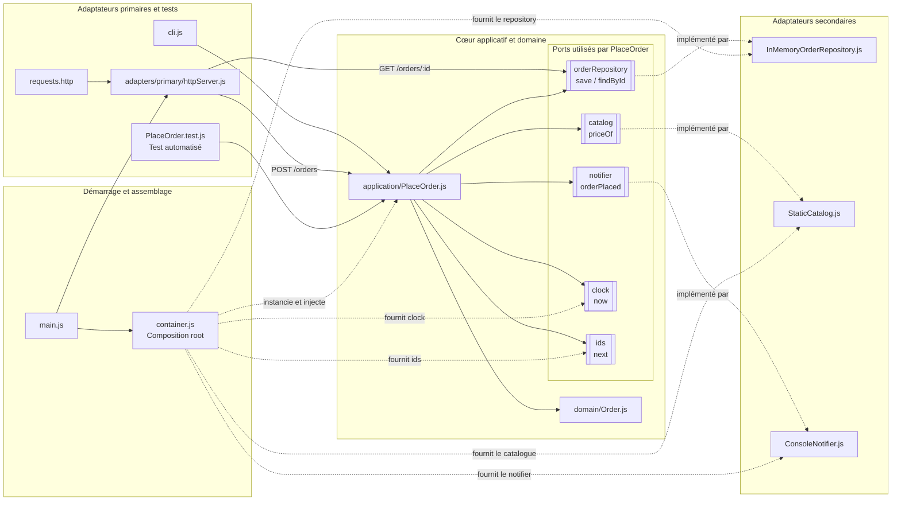

# TP 2 — Architecture hexagonale de ShopLite

**Parcours : Data — M1 INGETIS**  
**Binôme : Mahmoud Sow et Istichad Papa Mhoma**

## 1. Exécution du cas d’utilisation par trois portes

Le projet fourni permet de déclencher le même cas d’utilisation `PlaceOrder` depuis la ligne de commande, une API HTTP ou des tests automatisés. Les règles de création de commande sont centralisées dans le cœur applicatif et le domaine.

| Scénario | Résultat obtenu |
|---|---|
| Ligne de commande (CLI) | La commande `CMD-0001` est créée pour le client `C-42`, avec deux claviers à 49 € et une souris à 19 €. Total : **117 €**. Une notification de confirmation est affichée. |
| HTTP — commande valide | `POST /orders` renvoie **201 Created**. |
| HTTP — relecture | `GET /orders/CMD-0001` renvoie **200 OK** lorsque la commande existe. |
| HTTP — produit inconnu | Le produit `TELE` est refusé et l’API renvoie **400 Bad Request**. |
| HTTP — commande vide | Une commande sans ligne est refusée et l’API renvoie **400 Bad Request**. |
| Tests automatisés | **3 tests réussis, 0 échec**, exécutés avec Node.js v24.22.0. Ils vérifient l’enregistrement d’une commande valide, le refus d’un produit inconnu et le rejet d’une commande vide. Le serveur n’est pas nécessaire. |

Le contrôle d’architecture `npm.cmd run lint:archi` a été exécuté. Lors d’un test de violation volontaire, le lint a détecté l’import interdit de `FakePayment.js` dans `domain/Order.js`. Après suppression de cet import, le lint a confirmé que la règle était de nouveau respectée.

### Qu’est-ce qui reste identique et qu’est-ce qui change ?

Le cas d’utilisation `PlaceOrder` et les règles du domaine restent communs. Ce qui change est la porte d’entrée : arguments de commande, requête HTTP ou test automatisé. Les adaptateurs secondaires (catalogue, stockage et notification) sont fournis au cas d’utilisation par injection de dépendances.

## 2. Schéma de l’architecture hexagonale

### Place de `container.js`

`container.js` est la *composition root*. Il instancie le repository, le catalogue et le notifier, puis les injecte dans `PlaceOrder`. Il fournit également les dépendances `clock` et `ids`. Il se situe à la périphérie car il connaît à la fois le cas d’utilisation et les implémentations concrètes.

### Règle de dépendance

**Le domaine ne doit pas importer d’adaptateur ni de composant technique externe.** Les règles métier doivent rester indépendantes des détails de stockage, d’interface et de notification.

Le contrôle automatisé `npm.cmd run lint:archi` a confirmé que la règle est respectée après suppression de l’import interdit.

## 3. Conclusion

L’architecture hexagonale sépare le cas d’utilisation de ses moyens d’entrée et de sortie. Elle facilite les tests sans serveur et permet de remplacer le stockage ou le catalogue sans réécrire les règles du domaine. En contrepartie, elle demande davantage de fichiers et un assemblage explicite des dépendances.